<div align="center">


# 缇喵 Timiao

**好看、好用、真正原生的 EasyTier 安卓客户端**

内核就是官方 EasyTier，界面为手机重新设计。<br/>
点一下就连上，在哪都能回到自己的网络。


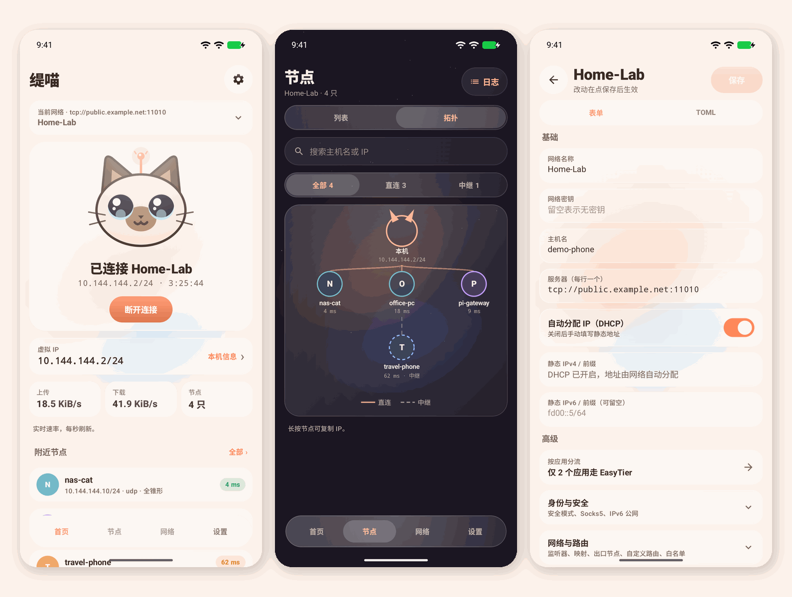

</div>

---

## 它是什么

[EasyTier](https://github.com/EasyTier/EasyTier) 是一个去中心化的组网工具：几台设备不管在哪，都能连成一个局域网，互相直连访问。

官方的安卓 App 由桌面端的跨平台界面改来，在手机上用起来不太顺手。缇喵把它重做成一个**安卓原生 App**：

- **内核不变**：直接编译官方 EasyTier 源码，打洞、中继、加密都和官方完全一致，可以和官方客户端放在同一个网络里。
- **界面重做**：用 Jetpack Compose 为手机重写。液态玻璃风格，有一只克制的小猫，支持深色模式和中英文。
- **功能更多**：官方 GUI 有的配置都有，还加了不少手机上才需要的便利功能。

## 亮点

<table>
<tr>
<td width="50%" valign="top">

### 🐾 一眼就懂的连接状态
首页显示一只猫：睡着是未连接，睁眼是已连接，掉线时会显示"正在重连"，不会假装还连着。
虚拟 IP、上下行速率、节点数量都在同一屏。

</td>
<td width="50%" valign="top">

### 🗺️ 看得见的网络拓扑
列表和拓扑两种视图。谁是直连、谁走中继、经过哪个节点转发，画得清清楚楚。
点开节点能看到每条连接的协议、延迟、丢包和流量。

</td>
</tr>
<tr>
<td valign="top">

### ⚙️ 官方全部配置，一个都不少
31 个高级开关、端口转发、子网代理、VPN Portal（可生成 WireGuard 客户端配置）、Magic DNS、IPv6……全部可以在表单里改。
也可以直接改 TOML 原文，表单和原文随时切换，字段不会丢。

</td>
<td valign="top">

### 📲 为手机准备的便利功能
- **扫码 / 链接分享**：一个二维码把配置发给朋友，默认不带密钥
- **按应用分流**：只让指定的 App 走 EasyTier
- **自动连接**：开机自启，按 Wi-Fi / 移动网络自动开关
- **桌面小部件 + 快捷设置磁贴**：不进 App 也能开关

</td>
</tr>
<tr>
<td valign="top">

### 🩺 连不上？一键诊断
自动检查配置、服务器可达性、NAT 类型、对端状态和手机权限。
用大白话告诉你问题在哪，再告诉你怎么改。

</td>
<td valign="top">

### 📊 流量心里有数
今日 / 本月用量、近 7 天柱状图。
可以设置"移动数据下不连接"或"超过 X MB 提醒"，不会偷跑流量。

</td>
</tr>
</table>

## 截图

| 首页（浅色） | 首页（深色） | 节点列表 | 拓扑（深色） |
|:---:|:---:|:---:|:---:|
| 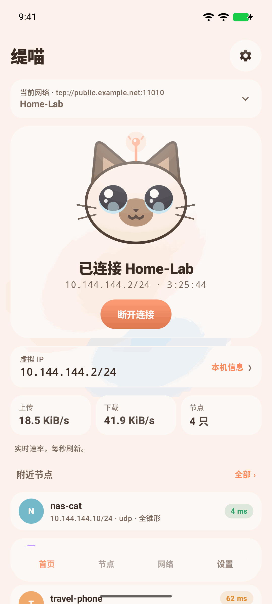 | 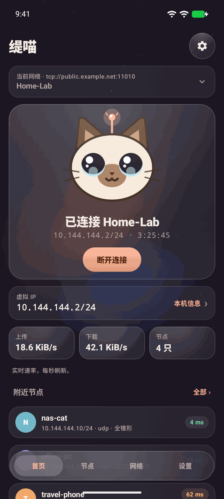 | 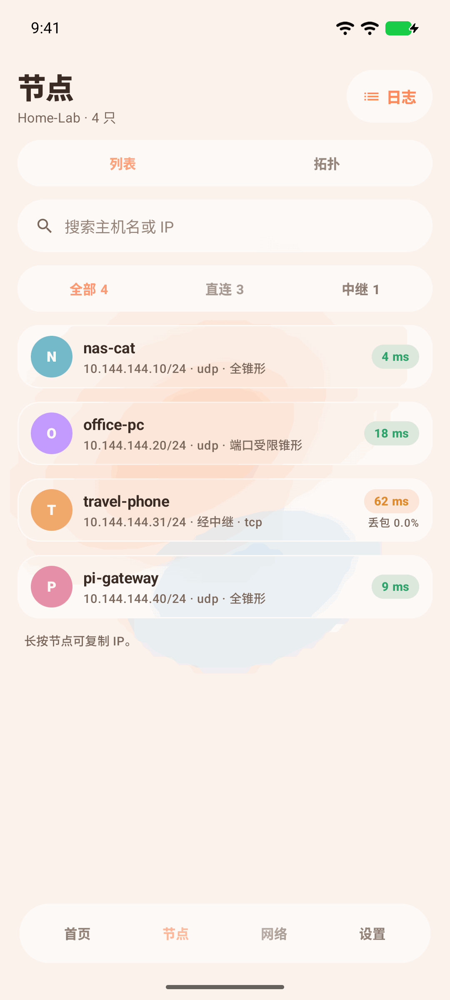 | 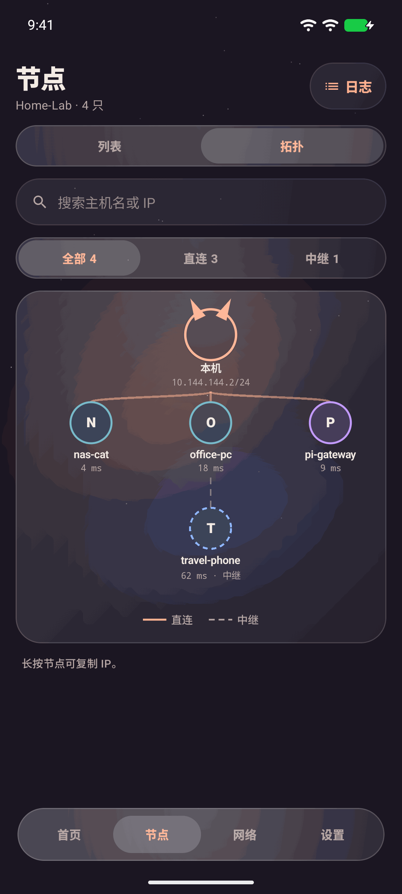 |

| 网络编辑 | 设置与工具 | 按应用分流 | 一键诊断 |
|:---:|:---:|:---:|:---:|
| 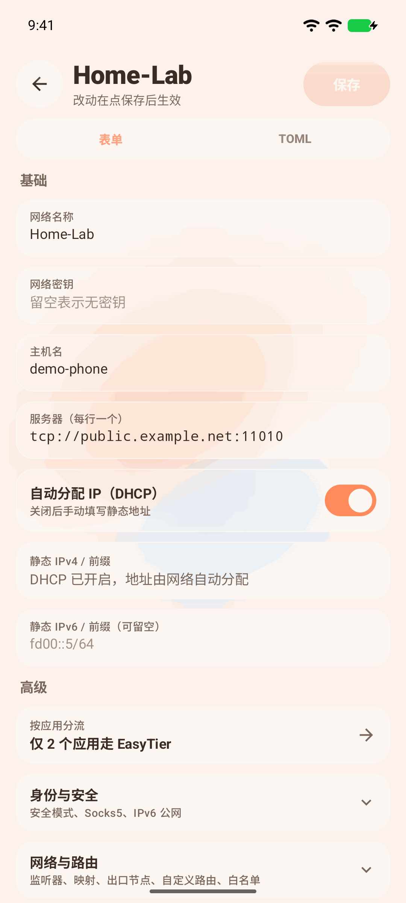 | 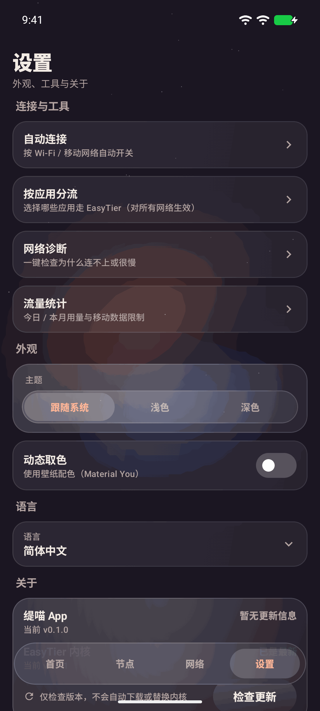 | 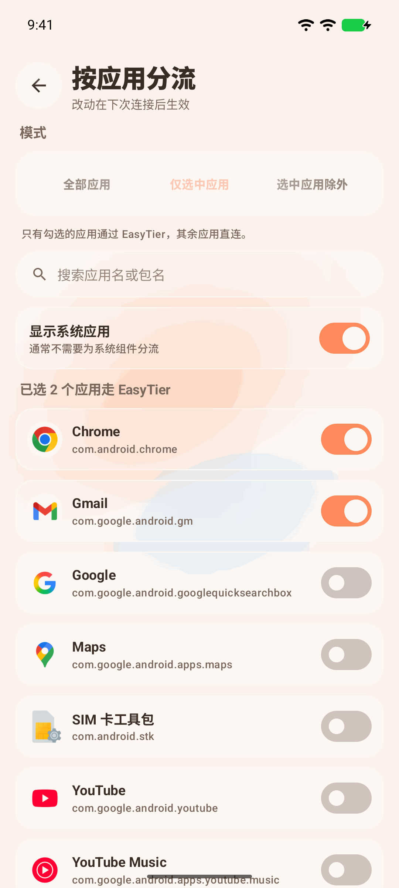 | 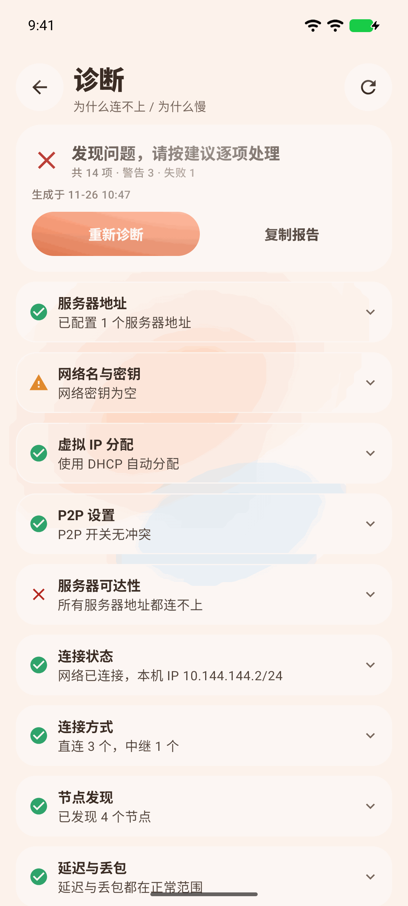 |

| 扫码分享 | English UI | 桌面小部件 |
|:---:|:---:|:---:|
| 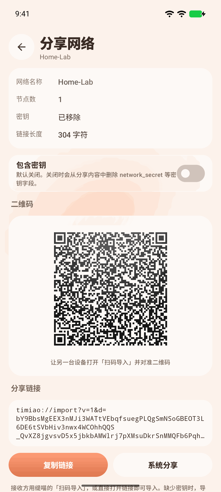 | 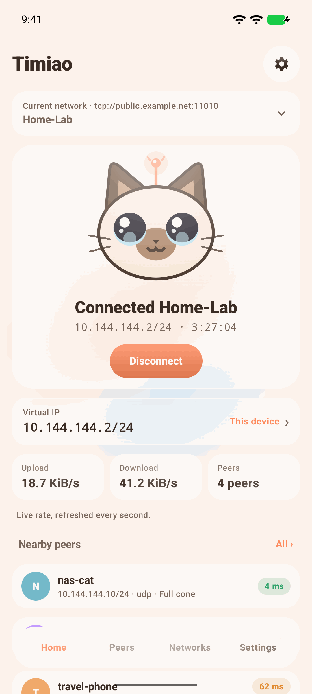 |  |

<sub>截图使用虚构的演示数据，不对应任何真实网络。</sub>

## 快速上手

1. **安装**：在 [Releases](../../releases) 下载最新的 `timiao-*-release.apk`，在手机上打开安装。
2. **添加网络**，任选一种：
   - 点「创建网络」，填写网络名、密钥和服务器地址；
   - 扫描朋友分享的二维码，或打开分享链接；
   - 导入现有的 `.toml` 配置文件（官方客户端导出的也可以）。
3. **连接**：点首页的「连接」，第一次需要允许 VPN 权限。连上后就能用虚拟 IP 访问网络里的其他设备。

> 💡 下拉手机的快捷设置，添加「缇喵」磁贴，以后一键开关。

## 和官方 GUI 的对照

| | 官方 GUI | 缇喵 |
|---|:---:|:---:|
| 内核 | EasyTier | **同一个官方内核** |
| 基础 / 高级配置、端口转发、子网代理 | ✅ | ✅ |
| VPN Portal 与 WireGuard 客户端配置 | ✅ | ✅ |
| Magic DNS、IPv6 | ✅ | ✅ |
| 节点表、本机信息、事件日志 | ✅ | ✅ |
| 同时连接多个网络 | ✅ | ✅（共用一张虚拟网卡） |
| ACL 规则 | 结构化编辑 | 原文编辑 |
| 扫码分享、按应用分流、自动连接 | — | ✅ |
| 一键诊断、流量统计、桌面小部件 | — | ✅ |

逐项对照和源码出处见 [`docs/parity-audit.md`](docs/parity-audit.md)。

## 内核与更新

- 内核来自官方 EasyTier 源码，版本固定在 [`kernel/UPSTREAM_TAG`](kernel/UPSTREAM_TAG)。
- 仓库里的 [GitHub Actions](.github/workflows/track-upstream.yml) 每天检查官方新版本。有新版本时会自动编译内核，并开一个 PR 等人工确认。目前 App 打包 64 位手机（arm64-v8a）和模拟器（x86_64）两种架构。
- 安卓不允许 App 下载并加载新的原生代码，所以内核升级 = 安装新版 App。设置页「关于」会显示当前内核版本，并提示官方是否有新版本。

## 隐私与安全

- **配置加密存储**：网络密钥等配置用 Android Keystore 加密后保存在本机，不上传任何地方。
- **日志不泄露密钥**：官方内核会把网络密钥写进系统日志。缇喵给内核打了两个小补丁（[`kernel/patches/`](kernel/patches)），日志里的密钥显示为 `***`。补丁失效时构建不会中断，会自动开 Issue 提醒更新。
- **分享默认不含密钥**：二维码、链接和导出文件默认去掉密钥；TOML 原文里的密钥默认遮盖。
- **不收集任何数据**：没有统计、没有广告。唯一的联网请求是 EasyTier 本身，以及「检查更新」时访问 GitHub。

## 从源码构建

需要 JDK 17 和 Android SDK（platform 35、NDK 27）。

```bash
# 1. 编译 EasyTier 内核（需要 Rust 与 cargo-ndk）
./scripts/build-kernel.sh --tag "$(cat kernel/UPSTREAM_TAG)" --abis arm64-v8a,x86_64
#    Windows：./scripts/build-kernel.ps1

# 2. 编译 App
./gradlew :app:assembleDebug

# 正式包：用环境变量指向你的签名配置（storeFile / storePassword / keyAlias / keyPassword）
TIMIAO_SIGNING=/path/to/signing.properties ./gradlew :app:assembleRelease
```

项目结构：

```
core/      纯 Kotlin：配置模型、TOML、内核桥接、状态解析、诊断
app/       Android App：界面（Compose）、VPN 服务、分流、自动连接、小部件
kernel/    官方内核的版本、补丁、许可说明
scripts/   内核编译脚本
docs/      架构说明、官方对照、截图
```

更多设计细节见 [`docs/ARCHITECTURE.md`](docs/ARCHITECTURE.md)。

## 已知限制

- ACL 规则目前只能编辑原文，还没有结构化编辑器。
- 两个网络不能使用重叠的网段同时运行，缇喵会拒绝并提示。
- App 进程被系统强制杀死后，通知栏可能残留一条旧通知，再次打开 App 即可清除。

## 致谢与许可

- 网络内核：[EasyTier](https://github.com/EasyTier/EasyTier)，以 LGPL-3.0 授权，作为独立的动态库加载。详见 [`kernel/LICENSE-NOTICE.md`](kernel/LICENSE-NOTICE.md)。
- 小猫是缇喵的原创形象，与任何现有角色无关。
- 缇喵自身代码的许可证尚未确定。

<div align="center">
<sub>Made with 🐾 for people who keep their devices in one network.</sub>
</div>
